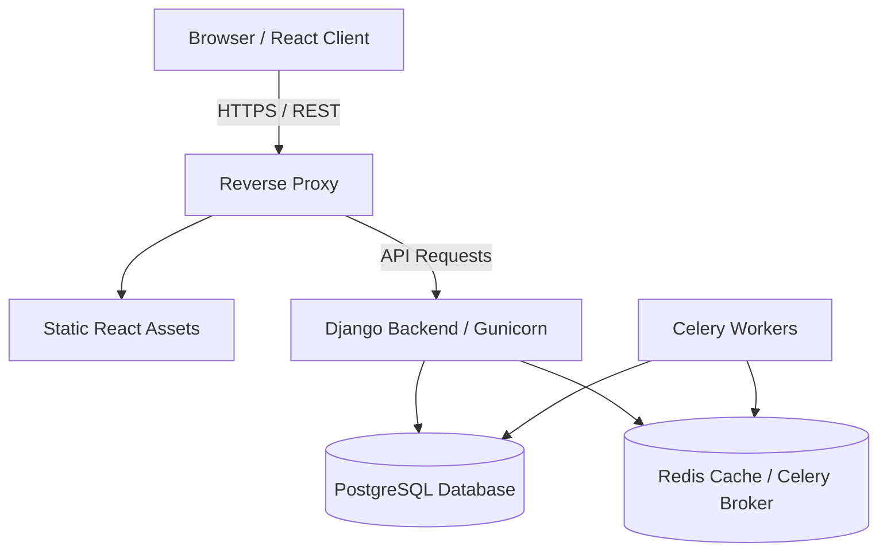

# Smart-HR: Technical Architecture

## Overview
Smart-HR is a modern Human Resources Information System (HRIS) designed to manage employee data, attendance, recruitment, and predictive analytics.

The application follows a decoupled client-server architecture:
- **Frontend**: A Single Page Application (SPA) built with React and TypeScript.
- **Backend**: A RESTful API built with Python and Django REST Framework (DRF).

## High-Level Architecture Diagram

## 1. The Backend (Django REST Framework)
The backend is responsible for business logic, data persistence, and security.

- **Framework**: Django 5.x + Django REST Framework.
- **Authentication**: JWT (JSON Web Tokens) managed via `djangorestframework-simplejwt`. Tokens are stored in HttpOnly cookies for security or passed via Authorization headers.
- **Apps Structure**:
  - `smart_hr.core`: Core utilities, email services, and shared logic.
  - `smart_hr.users`: Custom user model, authentication, and OTP.
  - `smart_hr.personnel`: Employees, departments, and roles.
  - `smart_hr.conge`: Leave request management workflow.
  - `smart_hr.ai_engine`: Predictive models for churn risk.

## 2. The Frontend (React + TypeScript)
The frontend provides a responsive and interactive user interface.

- **Framework**: React 18, Vite.
- **State Management**: React Context / Zustand (for global state) and React Query (for server state and caching).
- **Styling**: TailwindCSS with accessible UI components.
- **Routing**: React Router DOM.
- **Flow**:
  1. The user visits the app, the Vite-built static files are served.
  2. The frontend makes asynchronous `fetch` or `axios` calls to the Django API.
  3. React Query caches responses and updates the UI optimistically.

## 3. Communication Flow (Example: Leave Request)
1. **Action**: Employee clicks "Demander un congé" in the React UI.
2. **Request**: The frontend sends a `POST /api/v1/conges/` request with the leave details and the JWT token.
3. **Validation**: Django's `LeaveRequestSerializer` validates dates and overlap.
4. **Processing**: The `LeaveRequestViewSet` saves the request as `PENDING`.
5. **Notification**: A Celery task is triggered to send an email to the HR Manager.
6. **Response**: Django returns a `201 Created` status with the serialized object.
7. **UI Update**: React Query invalidates the `leave-requests` cache and refetches the list, showing the new request instantly.
