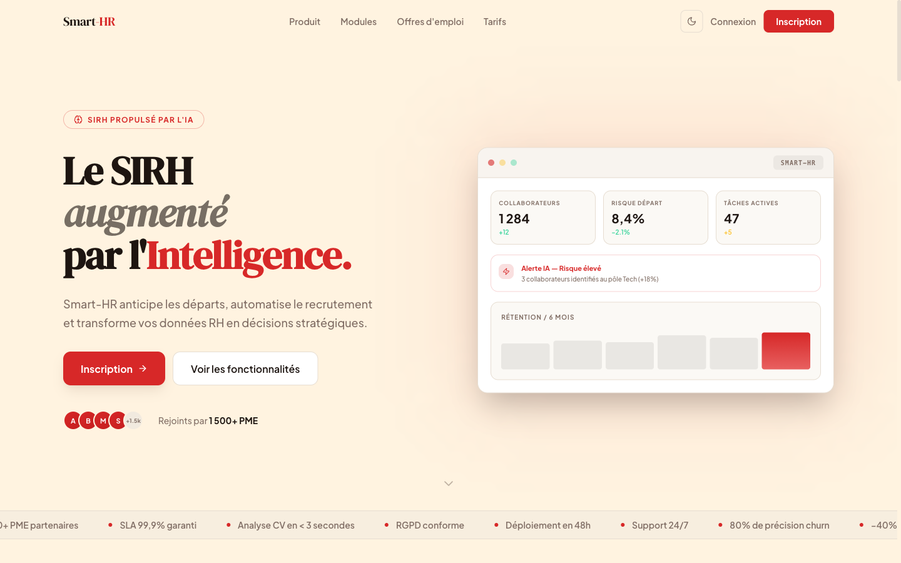
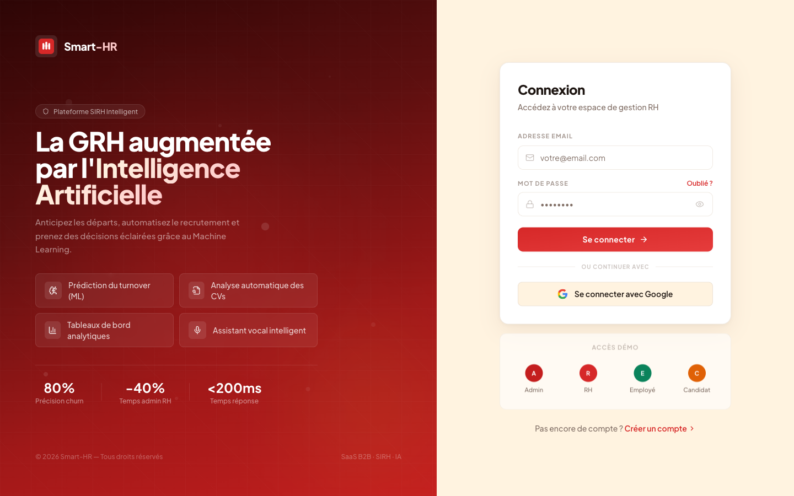
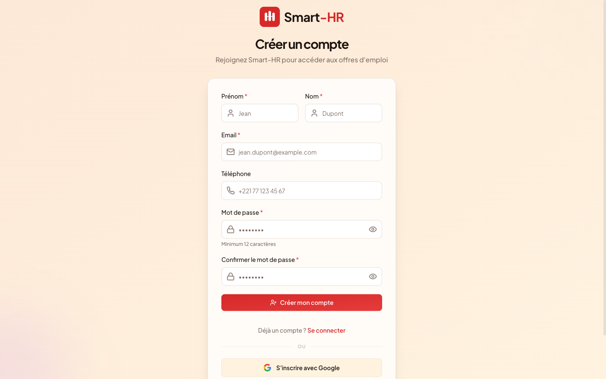
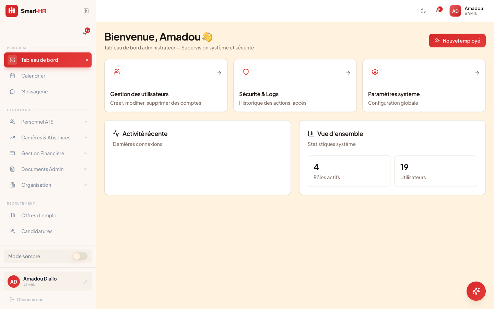
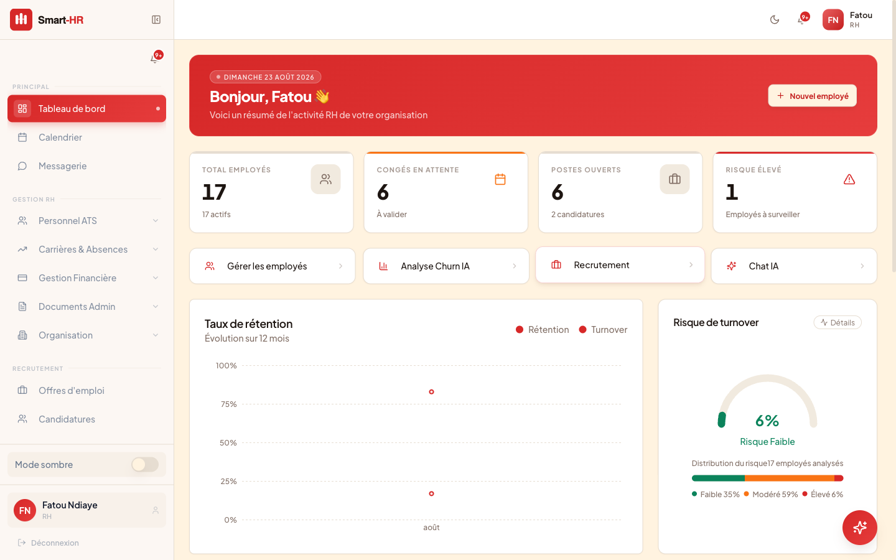
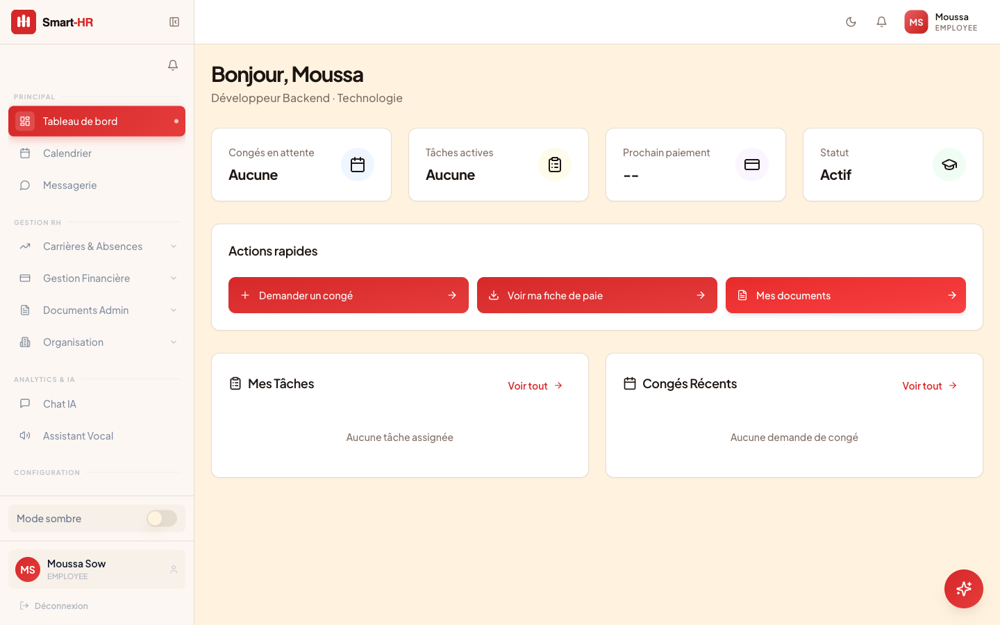
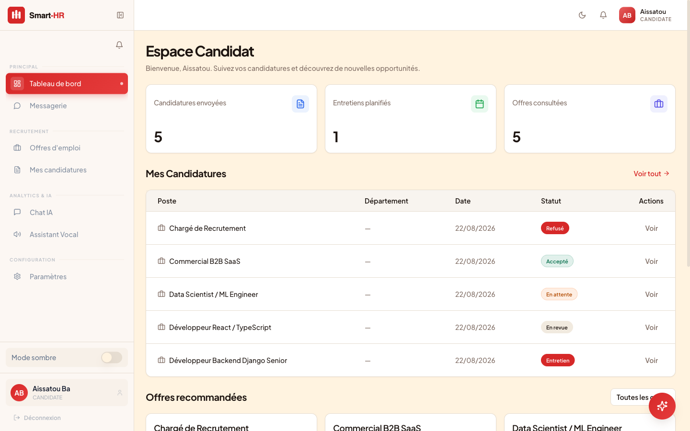

<div align="center">


<br/>
<br/>

<p>
  <strong>Système de Gestion des Ressources Humaines Intelligent</strong><br/>
  <em>Anticiper les départs · Automatiser le recrutement · Piloter vos talents</em>
</p>

<br/>

<!-- Backend -->
[](https://python.org)
[](https://djangoproject.com)
[](https://django-rest-framework.org)
[](https://docs.celeryq.dev)

<!-- Frontend -->
[](https://reactjs.org)
[](https://typescriptlang.org)
[](https://tailwindcss.com)
[](https://vitejs.dev)

<!-- Infra & AI -->
[](https://postgresql.org)
[](https://redis.io)
[](https://docker.com)
[](https://ai.google.dev)

<!-- Status -->
[](https://github.com/Zoubeir23/Smart-HR/actions)
[](LICENSE)

<br/>

[Démarrage rapide](#-démarrage-rapide) · [Aperçu](#aperçu-de-lapplication) · [Fonctionnalités](#-fonctionnalités) · [Architecture](#-architecture) · [Commandes Make](#commandes-make) · [IA Intégrée](#-ia-intégrée) · [Déploiement](#-déploiement)

</div>

---

## Présentation

**Smart-HR** est une plateforme SIRH nouvelle génération qui transforme la gestion RH d'une PME en outil proactif. Là où les SIRH classiques stockent passivement les données, Smart-HR les analyse en temps réel pour anticiper les démissions, automatiser le recrutement et assister les équipes RH avec un chatbot IA contextuel.

### Ce que Smart-HR fait concrètement

- **Prédit le churn** — Un modèle Random Forest entraîné sur 1 470 employés (dataset IBM) calcule un score de risque de départ 0–100 % avec explication de la cause principale
- **Analyse les CVs automatiquement** — Gemini 2.5 Flash extrait compétences, expériences et calcule un score de matching sémantique face à l'offre d'emploi
- **Conduit des entretiens vocaux** — Intégration Vapi (WebRTC) pour des sessions d'entretien IA avec feedback structuré en fin d'appel
- **Assiste les RH via chatbot** — Agent conversationnel multi-LLM (Gemini, OpenAI, Anthropic, Grok) avec actions directes sur la base de données
- **Gère l'ensemble du cycle RH** — Congés, présences, paie, documents, formations, tâches

---

## Aperçu de l'application

<div align="center">

| | |
|---|---|
|  |  |
| **Page d'accueil** | **Connexion** |
|  |  |
| **Inscription candidat** | **Dashboard Admin** |
|  |  |
| **Dashboard RH** | **Dashboard Employé** |
|  | |
| **Dashboard Candidat** | |

</div>

---

## Fonctionnalités

### Gestion du Personnel

| Module | Fonctionnalités |
|--------|----------------|
| **Profils Employés** | Informations complètes, contrat, salaire, manager, historique d'évaluations |
| **Congés** | Demande → Validation RH, suivi des soldes, calendrier partagé |
| **Présences** | Pointage quotidien, rapports mensuels |
| **Paie** | Historique salaires, fiches de paie |
| **Documents** | Upload sécurisé, contrats, attestations (par rôle) |
| **Formations & Réunions** | Catalogue, planification, lien de réunion (visioconférence externe) |
| **Tâches** | Kanban (À faire → En cours → En revue → Terminée) |

### Recrutement

| Module | Fonctionnalités |
|--------|----------------|
| **Offres d'Emploi** | Création/publication par le RH, listing public pour candidats |
| **Candidatures** | Upload CV (PDF), formulaire de postulation |
| **Analyse IA** | Score de matching sémantique Gemini (0–100), extraction automatique des compétences |
| **Filtrage** | Seuil de score configurable, tri par score décroissant |
| **Statuts** | Workflow en attente → entretien → accepté/refusé |

### Intelligence Artificielle

| Fonctionnalité | Technologie | Description |
|----------------|-------------|-------------|
| **Prédiction Churn** | Random Forest (scikit-learn) | Score de risque de départ + explication SHAP |
| **Analyse CV** | Gemini 2.5 Flash | Matching sémantique CV ↔ fiche de poste |
| **Recruteur IA Vocal** | Vapi WebRTC + Gemini | Entretien vocal IA avec feedback structuré |
| **Chatbot RH** | Multi-LLM (Gemini / OpenAI / Anthropic / Grok) | Assistant contextuel avec actions (chercher employé, créer congé...) |
| **Ré-entraînement Auto** | Celery Beat (hebdomadaire) | Le modèle churn se ré-entraîne automatiquement chaque semaine |

### Sécurité & Authentification

- JWT (access 30 min transmis dans l'en-tête `Authorization`, refresh 7 jours confiné à un cookie **HttpOnly** hors de portée du JavaScript)
- Argon2 (hachage des mots de passe)
- OTP email 6 chiffres (brute-force : verrouillage 15 min après 5 tentatives)
- RBAC : 4 rôles (Admin, RH, Employé, Candidat)
- **Aucune inscription libre** : les candidats passent par `/api/v1/auth/register/candidate/` (vérification OTP obligatoire), les comptes internes sont créés par un administrateur
- Réponses neutres sur l'inscription, la vérification et le renvoi d'OTP (pas d'énumération de comptes)
- Quotas dédiés : connexion (5/min), inscription (5/h), OTP (10/h), renvoi d'OTP (3/h), réinitialisation de mot de passe (3/h)

#### Variables d'environnement liées à l'authentification

| Variable | Rôle | Défaut |
|----------|------|--------|
| `DJANGO_ACCOUNT_ALLOW_REGISTRATION` | Ouvre l'inscription libre allauth. **À laisser à `False`** | `False` |
| `DJANGO_PASSWORD_RESET_TIMEOUT` | Validité (secondes) des liens de réinitialisation et d'invitation | `3600` |
| `DJANGO_JWT_COOKIE_SECURE` | Restreint le cookie de refresh au HTTPS (forcé en production) | `False` |
| `DJANGO_DEMO_PASSWORD` | Mot de passe des comptes de démo. **Obligatoire hors DEBUG** | — |
| `GOOGLE_OAUTH_CLIENT_ID` / `GOOGLE_OAUTH_CLIENT_SECRET` | Client OAuth2 du SSO Google | — |
- Content-Security-Policy sur l'API (Django) et sur le document HTML de la SPA (nginx)
- Fichiers sensibles (CV, contrats, bulletins de paie) servis via une vue protégée avec contrôle d'accès par propriétaire, URLs signées et expirantes en cas de stockage objet
- Logs d'audit (`AuditLog`) pour toutes les actions critiques
- Export RGPD des données personnelles (droit à la portabilité, endpoint dédié)
- Anonymisation RGPD des données d'un employé (droit à l'oubli, réservé Admin)
- Pages légales dédiées : Politique de confidentialité, CGU, RGPD, Mentions légales (`/privacy`, `/terms`, `/gdpr`, `/legal-notice`)

---

## Architecture

```
┌──────────────────────────────────────────────────────────┐
│              Frontend  React 18 + TypeScript + Vite       │
│  Pages · Composants · Services Axios · React Query        │
└────────────────────────┬─────────────────────────────────┘
                         │  REST API (JWT)
┌────────────────────────▼─────────────────────────────────┐
│              Backend  Django 6 + DRF                      │
│  users · personnel · recruitment · conge · ai · ai_engine │
│  Celery Workers  │  Celery Beat (cron hebdo)              │
└──────┬───────────┴──────────────────────┬────────────────┘
       │                                  │
┌──────▼───────┐              ┌───────────▼──────────────┐
│  PostgreSQL  │              │  Redis (cache + Celery)  │
└──────────────┘              └──────────────────────────┘
                                          │
              ┌───────────────────────────▼───────────────┐
              │  IA externe                                │
              │  Gemini 2.5 Flash · OpenAI · Anthropic     │
              │  Grok · Vapi (WebRTC voice)                │
              └───────────────────────────────────────────┘
```

### Structure du Projet

```
Smart-HR/
├── Backend/
│   ├── config/                 # Settings Django (base / local / production)
│   │   ├── settings/
│   │   │   ├── base.py
│   │   │   ├── local.py
│   │   │   └── production.py
│   │   └── urls.py
│   ├── smart_hr/
│   │   ├── users/              # Auth JWT, OTP, RBAC
│   │   ├── personnel/          # Employés, départements, postes
│   │   ├── recruitment/        # Offres d'emploi, candidatures, analyse CV
│   │   ├── conge/               # Demandes et validation de congés
│   │   ├── presence/            # Pointage et présences
│   │   ├── paiement/            # Salaires, bulletins de paie (moteur multi-pays)
│   │   ├── document/            # Gestion documentaire (contrats, attestations)
│   │   ├── formation/           # Formations et réunions
│   │   ├── tache/               # Gestion des tâches (Kanban)
│   │   ├── performance/        # Évaluations, feedback 360, coaching
│   │   ├── discipline/         # Actions disciplinaires
│   │   ├── communication/      # Messages internes, alertes de détresse
│   │   ├── survey/              # Enquêtes internes
│   │   ├── ai/                  # Chatbot multi-LLM + actions RH (function-calling)
│   │   ├── ai_agents/           # Sessions d'assistant vocal RH (mêmes LLM que le chatbot)
│   │   ├── ai_engine/           # Prédiction churn (Random Forest)
│   │   └── core/                # Modèles partagés, sécurité média, AuditLog
│   ├── pyproject.toml           # Dépendances (gérées via `uv`)
│   └── Dockerfile
│
├── Frontend/
│   ├── src/
│   │   ├── pages/              # Toutes les pages (dashboard, recrutement, IA...)
│   │   ├── components/         # Composants réutilisables
│   │   ├── services/           # Couche Axios (authService, recruitmentService...)
│   │   ├── hooks/              # Custom React hooks
│   │   ├── lib/                # Utilitaires et helpers
│   │   └── types/              # Types TypeScript partagés
│   ├── public/
│   │   ├── logo.svg            # Logo icône seul
│   │   └── logo-lockup.svg     # Logo + texte
│   └── Dockerfile
│
├── nginx/                       # Configuration reverse proxy
├── docker-compose.yml
└── .github/workflows/           # CI/CD GitHub Actions
```

---

## Démarrage Rapide

### Prérequis

- Python 3.13
- Node.js 18+
- PostgreSQL 15+
- Redis 7+
- Docker (optionnel, recommandé)

### Avec Make (le plus rapide)

Une fois les fichiers `.env` créés (voir [Variables d'Environnement](#variables-denvironnement)), tout se lance en une seule commande :

```bash
git clone https://github.com/Zoubeir23/Smart-HR.git
cd Smart-HR

mkdir -p Backend/.envs/.local
touch Backend/.envs/.local/.django Backend/.envs/.local/.postgres
cp Frontend/.env.example Frontend/.env
# Éditer les fichiers .env avec vos clés API

make init-all   # up + migrate + seed-demo, dans l'ordre, avec les temps d'attente nécessaires
```

La liste complète des commandes disponibles est dans la section [Commandes Make](#commandes-make) ci-dessous, ou via `make help`.

### Avec Docker (sans Make)

```bash
git clone https://github.com/Zoubeir23/Smart-HR.git
cd Smart-HR

# Créer les fichiers de variables d'environnement (voir la section
# "Variables d'Environnement" pour la liste complète des clés à renseigner)
mkdir -p Backend/.envs/.local
touch Backend/.envs/.local/.django Backend/.envs/.local/.postgres
cp Frontend/.env.example Frontend/.env
# Éditer les fichiers .env avec vos clés API

# Lancer tous les services
docker compose up -d

# Initialiser la base de données
docker compose exec django python manage.py migrate
docker compose exec django python manage.py seed_demo_data

# L'application est disponible sur http://localhost:8080
```

### Installation Manuelle

#### Backend

```bash
cd Backend

# Installer uv (gestionnaire de dépendances, remplace pip/venv)
pip install uv

# Installer les dépendances et créer l'environnement virtuel automatiquement
uv sync
source .venv/bin/activate

# Variables d'environnement — créer .envs/.local/.django (voir la section
# "Variables d'Environnement" ci-dessous pour la liste complète des clés)
mkdir -p .envs/.local
touch .envs/.local/.django .envs/.local/.postgres

# Base de données
python manage.py migrate
python manage.py seed_demo_data

# Lancer le serveur
python manage.py runserver
# API disponible sur http://localhost:8000/api/v1/
```

#### Frontend

```bash
cd Frontend

# Installer les dépendances
npm install

# Variables d'environnement
cp .env.example .env
# Éditer .env : VITE_API_URL=http://localhost:8000

# Lancer le serveur de développement
npm run dev
# Interface disponible sur http://localhost:5173
```

#### Workers Celery (pour ré-entraînement churn, tâches async)

```bash
cd Backend
# Worker
celery -A config.celery_app worker --loglevel=info

# Scheduler (Celery Beat)
celery -A config.celery_app beat --loglevel=info
```

### Comptes de Démonstration

| Rôle | Email | Mot de passe | Accès |
|------|-------|-------------|-------|
| **Admin** | `admin@smarthr.com` | `admin123` | Tout + gestion utilisateurs |
| **RH** | `rh@smarthr.com` | `rh123` | Dashboard RH, IA, recrutement, congés |
| **Employé** | `employee@smarthr.com` | `employee123` | Profil, congés, tâches |
| **Candidat** | `candidate@smarthr.com` | `candidate123` | Offres d'emploi, postuler |

---

## Commandes Make

Toutes les commandes agissent sur la stack Docker locale (`Backend/docker-compose.local.yml`), sauf mention contraire. Liste complète et à jour : `make help`.

### Initialisation

| Commande | Description |
|----------|-------------|
| `make init-all` | Setup complet : démarre les conteneurs, applique les migrations, charge les données de démo |
| `make reset` | ⚠️ Destructif — supprime les volumes Docker puis relance `init-all` de zéro |
| `make clean-all` | ⚠️ Destructif — supprime les volumes Docker et les fichiers de migration, sans relancer |

### Docker

| Commande | Description |
|----------|-------------|
| `make up` | Démarre tous les conteneurs en arrière-plan |
| `make down` | Arrête les conteneurs |
| `make down-v` | Arrête les conteneurs et supprime les volumes (perte des données locales) |
| `make restart` | Redémarre les conteneurs |
| `make build` | Reconstruit les images Docker |
| `make rebuild` | Arrête, reconstruit et relance les conteneurs |
| `make logs` | Suit les logs du backend Django en direct |
| `make celery-logs` | Suit les logs Celery (worker + beat) en direct |

### Frontend

| Commande | Description |
|----------|-------------|
| `make frontend-install` | Installe les dépendances npm |
| `make frontend-dev` | Lance le serveur de développement Vite (`localhost:5173`) |
| `make frontend-build` | Build de production |
| `make frontend-test` | Lance les tests Vitest |
| `make frontend-lint` | Vérifie le code avec ESLint |

### Django

| Commande | Description |
|----------|-------------|
| `make shell` | Ouvre le shell Python Django (`manage.py shell`) |
| `make dbshell` | Ouvre le shell PostgreSQL (`psql`) |
| `make migrate` | Applique les migrations en base |
| `make migrate-local` | Applique les migrations sans Docker (SQLite) |
| `make makemigrations` | Génère les fichiers de migration |
| `make makemigrations-local` | Génère les fichiers de migration sans Docker (SQLite) |
| `make delete-migrations` | Supprime tous les fichiers de migration existants |
| `make check` | Vérifie la configuration Django (`manage.py check`) |
| `make test` | Lance la suite de tests pytest du backend |
| `make createsuperuser` | Crée un compte super-administrateur |
| `make collectstatic` | Collecte les fichiers statiques |
| `make flush-db` | Vide les données de la base (conserve les tables) |
| `make seed-demo` | (Re)génère les données de démonstration |
| `make docs-build` | Construit la documentation MkDocs |

---

## IA Intégrée

### Prédiction de Churn (Machine Learning)

Le modèle Random Forest est entraîné sur le dataset IBM HR Analytics (1 470 employés, 35 features). Il prédit la probabilité de départ d'un employé avec un score 0–100 % et affiche la cause principale identifiée.

```bash
# Ré-entraîner manuellement le modèle
python manage.py train_churn_model

# Ou déclencher via l'API (RH/Admin uniquement)
POST /api/v1/ai-engine/retrain/
```

Le ré-entraînement automatique s'exécute chaque semaine via Celery Beat (configurable dans `CELERY_BEAT_SCHEDULE`).

### Analyse de CV (Gemini 2.5 Flash)

Lors d'une candidature, Gemini analyse le CV en PDF et génère un score de matching sémantique (0–100) par rapport à la description du poste. Le score est stocké sur le modèle `Application` et filtrable depuis le dashboard RH.

### Recruteur IA Vocal (Vapi)

La page `/ai/recruteur` intègre le SDK Vapi WebRTC pour conduire des entretiens vocaux IA en temps réel. Un feedback structuré (points forts, points faibles, recommandation) est généré automatiquement à la fin de chaque session.

Configuration requise :
```env
VITE_VAPI_PUBLIC_KEY=votre_cle_publique_vapi
```

### Chatbot RH Multi-LLM (actionnable)

L'assistant conversationnel supporte 4 fournisseurs de LLM configurables :

| Fournisseur | Modèle par défaut | Variable d'env |
|-------------|------------------|----------------|
| **Google Gemini** (défaut) | `gemini-2.5-flash` | `GEMINI_API_KEY` |
| **OpenAI** | `gpt-4o-mini` | `OPENAI_API_KEY` |
| **Anthropic** | `claude-3-5-haiku` | `ANTHROPIC_API_KEY` |
| **xAI Grok** | `grok-3-mini` | `GROK_API_KEY` |

Au-delà de la conversation, le chatbot exécute directement des actions métier via function-calling natif, filtrées par rôle :

| Action | Rôles | Exemple |
|--------|-------|---------|
| Poser un congé | Employé, RH, Admin | « Pose un congé du 12 au 15 août » |
| Valider/refuser un congé | RH, Admin | « Valide le congé de Awa Diallo » |
| Créer un objectif OKR | Employé, RH, Admin | « Crée un objectif de 10 clients signés pour Q1 » |
| Créer un programme d'onboarding | RH, Admin | « Crée un onboarding pour Awa Diallo » |
| Créer une offre d'emploi | RH, Admin | « Crée une offre pour un développeur Django » |

Une fiche de poste ou un document peut être joint au message : son contenu (assaini contre l'injection de prompt) alimente à la fois la réponse conversationnelle et la détection d'action — « crée l'offre à partir de ce fichier » fonctionne directement.

Le chatbot détecte la confusion de l'utilisateur (2 réponses consécutives hors-contexte) et propose automatiquement une escalade vers un RH humain.

---

## Déploiement

### Production avec Dokploy (VPS)

Le projet est déployé sur VPS avec Dokploy comme orchestrateur Docker. La configuration complète est disponible dans `Docs/`.

```bash
# Variables d'environnement de production critiques
DATABASE_URL=postgres://...
REDIS_URL=redis://...
DJANGO_SECRET_KEY=...
DJANGO_SETTINGS_MODULE=config.settings.production

# IA
GEMINI_API_KEY=...
VITE_VAPI_PUBLIC_KEY=...

# Email (SMTP Gmail)
EMAIL_HOST=smtp.gmail.com
EMAIL_PORT=587
EMAIL_HOST_USER=...
EMAIL_HOST_PASSWORD=...  # App password Gmail
```

### CI/CD GitHub Actions

Deux workflows (`.github/workflows/ci.yml` et `cd.yml`) :

**CI** — 4 jobs en parallèle sur chaque push/PR vers `main` :
1. **Backend — Lint** : hooks pre-commit (ruff, djLint, django-upgrade)
2. **Backend — Tests** : `pytest` dans un environnement Docker Compose complet (PostgreSQL inclus)
3. **Frontend — Quality** : `tsc --noEmit`, ESLint, Vitest, build de production
4. **Security — Trivy Scan** : scan de vulnérabilités (dépendances + filesystem)

**CD** — se déclenche uniquement si la CI complète réussit :
1. Build et push des images Docker (Backend + Frontend) vers GHCR
2. Scan Trivy des images construites
3. Déploiement automatique sur le VPS

### Nginx

Le frontend est servi par nginx avec deux configurations :
- `Frontend/nginx.vps.conf` — utilisée en production (Dockerfile) : proxy `/api/` et `/admin/` vers Django, Content-Security-Policy et headers de sécurité sur le document HTML de la SPA, blocage des scans de vulnérabilités courants, cache 1 an sur les assets statiques
- `Frontend/nginx.conf` — configuration de développement, plus minimale

---

## Variables d'Environnement

### Backend (`Backend/.envs/.local/.django`)

```env
# Général
USE_DOCKER=yes
DJANGO_SECRET_KEY=your-secret-key   # generer via: python -c "import secrets; print(secrets.token_urlsafe(50))"
IPYTHONDIR=/app/.ipython

# Cache & Celery
REDIS_URL=redis://redis:6379/0
CELERY_FLOWER_USER=your_flower_user
CELERY_FLOWER_PASSWORD=your_flower_password

# Email — Gmail SMTP (OTP, notifications recrutement)
EMAIL_HOST=smtp.gmail.com
EMAIL_PORT=587
EMAIL_USE_TLS=True
EMAIL_HOST_USER=your@gmail.com
EMAIL_HOST_PASSWORD=your_app_password

# Admin — notifications d'erreurs Django
DJANGO_ADMIN_NAME=Admin
DJANGO_ADMIN_EMAIL=admin@example.com

# IA — Google Gemini par défaut ; les autres fournisseurs sont optionnels
GEMINI_API_KEY=...
OPENAI_API_KEY=...
ANTHROPIC_API_KEY=...
GROK_API_KEY=...
```

### Base de données (`Backend/.envs/.local/.postgres`)

```env
POSTGRES_HOST=postgres
POSTGRES_PORT=5432
POSTGRES_DB=smart_hr
POSTGRES_USER=smart_hr
POSTGRES_PASSWORD=your-password
```

### Frontend (`Frontend/.env`)

```env
VITE_API_URL=http://localhost:8000
VITE_VAPI_PUBLIC_KEY=your_vapi_public_key
```

---

## Tests

765 tests backend (pytest) et 238 tests frontend (Vitest), exécutés à chaque push via la CI.

```bash
# Backend — tests unitaires et d'intégration
cd Backend
pytest

# Avec couverture
pytest --cov=smart_hr --cov-report=term-missing

# Frontend — type checking
cd Frontend
npx tsc --noEmit

# Linting
npm run lint
```

---

## Documentation

| Document | Description |
|----------|-------------|
| [Comptes Démo](Docs/COMPTES_DEMO.md) | Identifiants de démonstration |
| [Guide Déploiement](Docs/Deployment/) | Instructions complètes VPS/Docker |
| [Audit Sécurité](Docs/Audit/) | Rapport d'audit et checklist de sécurité |
| [Rapport VPS](memoire-soutenence/vps/vpd.md) | Validation complète du déploiement production |

---

## Contribution

1. Forker le dépôt
2. Créer une branche : `git checkout -b Feature/XXX-description`
3. Commiter : `git commit -m "feat: description"`
4. Pousser : `git push origin Feature/XXX-description`
5. Ouvrir une Pull Request

---

## Auteur

**Zoubeir IBRAHIMA AMED**  Projet de soutenance HESTAFRICA 2026

[GitHub](https://github.com/Zoubeir23)

---

## Licence

MIT — voir [LICENSE](LICENSE)

---

<div align="center">


<br/>

**Smart-HR** · SIRH Intelligent · HESTAFRICA 2026

</div>
